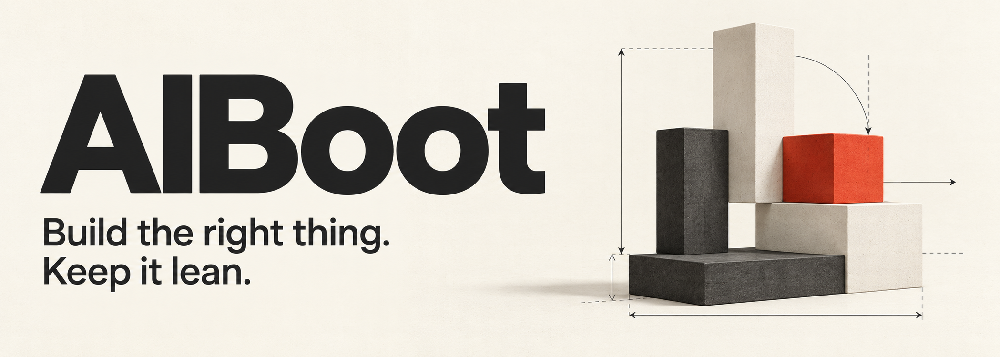

<p align="center">
  
</p>

<p align="center">
  <strong>Engineering judgment for AI coding agents.</strong><br>
  Clear scope · Proven building blocks · Evidence of completion
</p>

<p align="center">
  <strong>English</strong> · <a href="README.zh-CN.md">简体中文</a><br>
  <a href="#quick-start">Quick start</a> · <a href="docs/setup.md">Setup guide</a> · <a href="#status-and-next-work">Status</a> · <a href="CONTRIBUTING.md">Contribute</a>
</p>

---

# AIBoot

AIBoot is a lightweight engineering starter for **AI coding agents**. It helps
an agent start from a clear goal, consider existing solutions, and choose
implementation and verification work that fit the actual project.

**One core file to add. Your coding tool handles execution.** The kit contains
English engineering guidance and local loading guides for **Codex, Cursor, and
Claude Code**. Planning, permissions, session recovery, and permitted subagents
stay with your tool; your project keeps its own stack and layout.

**Experimental alpha · `v0.2.0-alpha.4` · MIT.** Source checks and documented copy
guards are tested. Native discovery and behavior validation have different scopes;
see [status](#status-and-next-work). No measured token savings are claimed.

## Why AIBoot

An agent can produce a detailed plan while quietly adding work you never needed:
a frontend for a CLI, a custom implementation of a mature library, or an
infrastructure stack justified only by the phrase “production-ready.”

AIBoot puts a few engineering decisions at the center of the work:

- **Start from the outcome.** Separate requirements, assumptions, and suggestions.
  A plan does not turn every suggestion into a promise.
- **Reuse before building.** Consider existing projects, maintained libraries,
  official starters, and available capabilities. Match specialized work to suitable
  Skills and tools; discover additions when existing methods leave a useful gap.
- **Make complexity earn its place.** Architecture and quality targets need a
  current reason. Existing platforms and real failure impacts count as reasons.
- **Plan the next useful result.** Detail nearby work; expand future work as facts
  emerge. Keep records when they help a decision or a handoff.
- **Finish with evidence.** Run relevant checks, report what actually happened,
  and stop when the requested result is demonstrated.

The agent can choose a sensible path for a script, an internal app, a customer
product, or a project with substantial constraints.

## Quick start

Clone with `git clone https://github.com/Liu-2026/AIBoot.git`, or
[download the ZIP](https://github.com/Liu-2026/AIBoot/archive/refs/heads/main.zip).
In your destination project, add the core:

```sh
AIBOOT_SOURCE="/absolute/path/to/AIBoot"
test ! -e AGENTS.md && test ! -L AGENTS.md && \
  cp "$AIBOOT_SOURCE/scaffold/AGENTS.md" AGENTS.md
```

This POSIX-shell example leaves an existing file or symlink untouched. If project
instructions already exist, merge useful guidance in your editor. On Windows,
copy the same file manually. The [setup guide](docs/setup.md) covers local changes,
license notices, updates, and removal.

Choose your tool’s loading guide:

- [Codex](adapters/codex/README.md): project `AGENTS.md`.
- [Cursor](adapters/cursor/README.md): project `AGENTS.md`.
- [Claude Code](adapters/claude-code/README.md): direct `AGENTS.md` loading where
  supported, or a project-local `CLAUDE.md` import.

Then describe the result you need:

```text
Build a local CLI that summarizes CSV expenses by category.
It is for my own use; no web interface is needed.
Start with the first working result and show how you verified it.
```

For a planning stage, say “plan only; do not implement yet.” To resume work,
reference the current task and existing facts. A clear task can proceed directly;
starting a new session does not require a new project plan.

## Use your existing capabilities

The default core includes **task triggers and discovery sources**. At project
start, a material task change, or a new specialized need, it guides the agent to
match the work to suitable native capabilities. You can describe the outcome
without knowing a Skill name or adding a second file.

Actual UI work can use an appropriate design skill; an SDK question can use a
connected Context7 tool or official versioned docs. External account access can
use an existing integration or native plugin/MCP discovery. A help-text edit can
proceed directly. Installed Skills, connected tools, and sufficient project methods
come first. For remaining gaps, focused upstream search, skills.sh, and public MCP
metadata provide candidates; private integrations use organization sources.

The optional [capability reference](scaffold/capabilities.md) adds ten routes,
covering documentation, UI, React, browser verification, Postgres, mobile, Azure
SDKs, security review, document artifacts, and service integrations. It explains
fit, limits, and failure paths and is read through the
[optional setup](docs/setup.md#optional-capability-discovery) on demand.

A directory listing does not prove working access. The guidance calls for relevant
use and honest fallback when discovery or execution fails. AIBoot bundles no
third-party Skills, runs no installer, and manages no plugins. These are engineering
instructions; automatic selection and third-party effectiveness still need evidence.

The previous startup and selection Skills overlapped with the core and had no
demonstrated incremental benefit. They remain removed from distribution. Existing
alpha users can follow the [migration notes](docs/setup.md#migrate-from-the-first-alpha).

## What it looks like in practice

These are intended behaviors, not benchmark results:

- **A small booking app:** begin with a useful booking flow. Add deployment
  complexity when actual hosting or operations requires it.
- **An internal help desk:** investigate a suitable existing application before
  committing to a custom ticketing system.
- **A branded page:** use real content, references, and an appropriate installed
  design skill. Visual direction follows the product and its users.
- **A help-text edit:** make the scoped change and check relevant behavior.
- **A task resumed later:** use current facts and applicable evidence, then
  continue. Save context that future work would otherwise lose.

## A small, portable architecture

```text
scaffold/AGENTS.md            # single source of engineering guidance
scaffold/capabilities.md      # optional task-specific upstream references
adapters/                    # tool-specific loading details
docs/setup.md                # shared setup, migration, updates, and removal
docs/assets/aiboot-hero.png   # README artwork
```

Add the core to your tool’s native instruction entry. Plans, issues, test commands,
CI, application structure, and useful project facts stay in their existing homes.
AIBoot adds no service or application dependency.

## Status and next work

The current alpha keeps one default core with task-based capability matching,
direct source entry points, and failure guidance. Native Skills and tools handle
execution; the detailed reference remains optional. Startup and selection guidance
stay consolidated, with no separate facts template or discovery service.
The latest revision favors sufficient verification alternatives and judges tool
findings against confirmed project constraints.

Codex CLI `0.162.0-alpha.17.2` input previews confirmed that the complete core appears
once after copying and is absent before copying and after removal. This checks
native instruction discovery without a model run. The optional reference body
remained absent even with the file present and a plain instruction pointer.
Read-only native plugin search and Context7 documentation queries succeeded in a
local maintainer check. This verifies those available paths, not automatic task
routing by itself.

A small local `alpha.3` behavior trial compared fresh native and core sessions on
the same inventory-viewer task. Both selected an installed design skill and their
pages passed 11 independent browser checks. On identical working-app copies, both
made a one-line placeholder edit and passed three focused browser checks without
reading a design Skill. The core's greenfield session reached the evaluation time
limit during verification after browser-tool failures; its page passed, but a clean
delivery was not demonstrated within that run. This prompted the narrower fallback
guidance. A single task does not establish a general benefit or Token reduction.
An `alpha.4` completion run then preserved the existing app, reused its saved
browser evidence, checked logic and local serving, and repaired verification
documentation. It reported fresh browser checks as unavailable. This recovery
trial had a different starting state and is not a greenfield performance comparison.

Cursor and Claude Code loading, broader capability selection, private-service
failure handling, cross-tool coexistence, and remote/cloud use remain untested.
Source checks validate publication files and copy guards, not engineering decisions
or measured token savings.

- [Setup guide](docs/setup.md) covers migration, updates, and removal.
- [Contributing](CONTRIBUTING.md) explains the Git/PR workflow and local checks.

## Help shape the kit

Share a small, reproducible task where the instructions helped, added unnecessary
work, or failed to preserve scope. Include your tool and version, and distinguish
observed behavior from an expectation. Removing an unhelpful rule is a useful
contribution.

If this approach fits how you build, **star AIBoot** and help others discover it.

## License

[MIT](LICENSE). The README uses original artwork generated for AIBoot.
